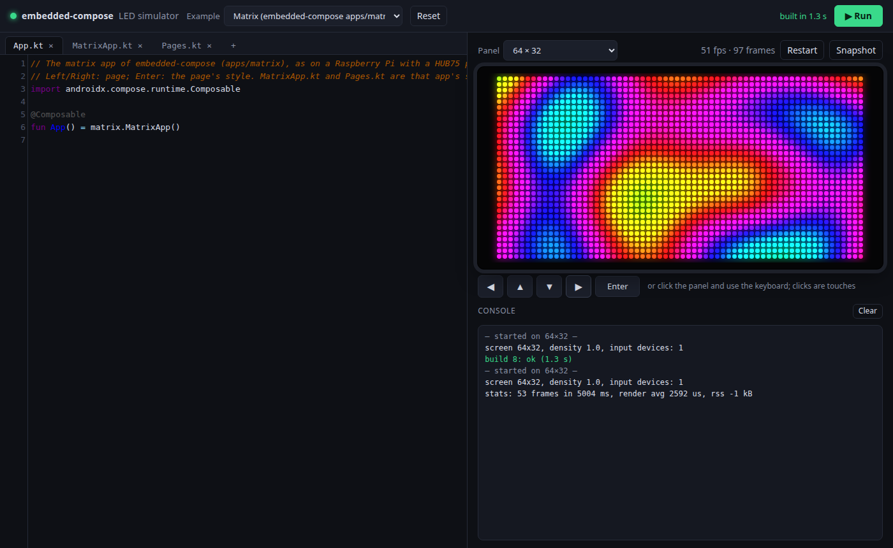

# embedded-compose-hub75-playground: Compose for HUB75 LED panels, in the browser

Write Compose code for an LED matrix in the browser, press **Run**, and
watch it on a simulated HUB75 panel. The code is compiled with
[embedded-compose](https://github.com/kaiwalyakhasnis/embedded-compose)'s own toolkit, and drawn by that
project's own LED-matrix backend, so what you see is what the Raspberry Pi
sends to the panel.

**Try it: https://kaiwalyakhasnis.github.io/embedded-compose-hub75-playground/** (nothing to
install; a recent Chrome, Edge, Firefox or Safari)

[](https://kaiwalyakhasnis.github.io/embedded-compose-hub75-playground/)

## Run it

You need a JDK (17 or newer), Python 3, `curl`, and an embedded-compose checkout
next to this directory (or set `EC_DIR`).

```sh
./server.py                  # then open http://127.0.0.1:8075/
```

The first start downloads wasi-sdk (115 MB, checksum-verified, into `out/deps`)
and Gradle's dependencies, and builds everything. That takes a few minutes.
After that, a Run takes 2–8 s, and one with unchanged code takes about 1 s.
The server listens on 127.0.0.1 only.

## On GitHub Pages (no server)

```sh
./pages.py                   # the static site, in out/pages (1.8 MB)
```

The static site needs no server. The examples run prebuilt, so they start
at once. Edited code is compiled by JetBrains' public
[Kotlin Playground](https://play.kotlinlang.org) server (api.kotlinlang.org),
the one kotlinlang.org's embeddable playground uses. The page sends your
files and the toolkit's sources (`toolkit.json`), using the newest Kotlin
the server has Compose for (2.4.0 now). It gets back wasm that loads the
Kotlin and Compose runtime from JetBrains' CDN.
- A Run takes about 20 s.
- The first one downloads about 12 MB of runtime, which the browser then caches.
- Your code goes to JetBrains, and this only works while that service does.

`.github/workflows/pages.yml` builds and publishes it when run from the
Actions tab, once the repository's Settings → Pages → Source is "GitHub
Actions". Add a `push` trigger to publish on every push.
It checks out embedded-compose from GitHub next to it.

The page needs a browser with WebAssembly GC: Chrome or Edge 119+, Firefox
120+, or Safari 18.2+.

## Using it

- **Examples:** *Matrix* is embedded-compose's `apps/matrix`, its sources
  unchanged: a clock, a plasma, Life and a marquee. *Hello*, *Bounce* and
  *Fire* are short starters. Your edits are kept in the browser for each
  example, and **Reset** undoes them.
- **Code:** one file must define `@Composable fun App()`. Use **+** to add
  more files. The API is embedded-compose's toolkit (`ui.*`): `Box`, `Row`,
  `Column`, `Text`, `Canvas`, `drawRect`/`drawCircle`/`drawText`, modifiers,
  `rememberFrameMillis()`, `animateFloatAsState()`, plus the Compose runtime
  (`remember`, `LaunchedEffect`, …). One dp is one LED. Text uses the
  panel's 5x7 font.
- **Input:** click the panel, then use the keyboard. Keys arrive in
  `Device.onKey` as Linux key codes, as from a USB keyboard or GPIO
  buttons on the Pi. The buttons under the panel send Left, Up, Down, Right
  and Enter. Mouse clicks are touches (`Modifier.pointerInput`,
  `clickable`).
- **Panel:** 32×16 to 128×64. Changing the size restarts the app without
  recompiling. **Snapshot** saves a PNG.
- **Ctrl+Enter** (or Ctrl+S) runs. Compiler errors are marked in the editor
  and listed in the console; click an entry to jump to it. `log("...")`
  prints to the console.

## How it works

```
 editor ──POST /api/compile──▶ server.py ──▶ Gradle, Kotlin/Wasm
                                                │
   embedded-compose core/ui (toolkit) ──────────┤  compiled as is
   toolkit/: hal/Hal.kt, ui/WebRuntime.kt ──────┤  this project's
   your files (out/playground/src) ─────────────┘
                                                ▼
 sim.html ◀── playground.wasm ── calls ec_hal.h ──▶ ecHal (site/hal.js)
    │                                                  │
    │       embedded-compose backends/matrix/matrix.cpp ┤ led.wasm (wasi-sdk,
    │       led/web_sink.cpp, led/png_web.cpp ──────────┘  led/build.sh)
    ▼
 site/panel.js: each pixel of the frame is an LED on a canvas
```

**The same as on the Pi:**
- **The toolkit:** core/ui, compiled from the embedded-compose checkout,
  including `Runtime.kt` (its event loop, input dispatch and `Device`).
  Only `runApp()` is cut out at build time.
- **The pixels:** `backends/matrix/matrix.cpp`, which handles fills, alpha
  blending and the 5x7 font, compiled from that checkout to WebAssembly.
  Its frames go to the page instead of to rpi-rgb-led-matrix.
- **The app code:** `apps/matrix` compiles unchanged. Its `platform.posix`
  wall-clock calls (`time`, `localtime_r`, `clock_gettime`) are served by a
  small shim that uses the browser's clock (`toolkit/src/wasmJsMain/kotlin/posix`).

**Different from the Pi:**
- **`runApp()`:** on the device it blocks waiting for input. A page can't
  block, so `ui/WebRuntime.kt` runs the same loop body one step at a time,
  with each next step scheduled by the page.
- **The panel's look:** the simulator shows the RGB frame. A real panel
  adds PWM and colour depth, luminance correction, the refresh rate and
  brightness, so colours and dim levels differ a little.
- **Images:** the simulator has none yet (`ImageBitmap.load` returns null).
- **Native code:** only the wall-clock part of `platform.posix` exists, and
  other `kotlinx.cinterop` code (sysfs, files) won't compile.

## To a real panel

The playground's files make an embedded-compose app. Put them in an app
directory with a `build.gradle.kts` and a `Main.kt` like
`embedded-compose/apps/matrix`'s. Then build it with
`APP_DIR=<dir> ./ec build rpi-hub75` there and copy it to the Pi with
`./ec run rpi-hub75`.

## Layout

| | |
|---|---|
| `server.py` | web server, examples, compile calls |
| `pages.py` | the static site for GitHub Pages; `.github/workflows/pages.yml` publishes it |
| `site/` | the page: `index.html` + `playground.js` (editor), `sim.html` (one run), `hal.js` (ec_hal.h glue), `panel.js` (LED canvas) |
| `toolkit/` | Gradle module: embedded-compose's core/ui for Kotlin/Wasm, with `hal/` and `ui/WebRuntime.kt`, and the posix/cinterop shims |
| `playground/` | Gradle module: the editor's files plus `main()` |
| `led/` | `build.sh`: matrix.cpp to `out/web/led.wasm`, with a browser sink and a PNG stub |
| `examples/` | the starters |
| `out/` | builds, wasi-sdk, the playground's current files |

## Licences

This repository has no licence yet. The page loads
[CodeMirror 5](https://codemirror.net/5/) (MIT) from cdnjs. `led/build.sh`
downloads [wasi-sdk](https://github.com/WebAssembly/wasi-sdk) (Apache-2.0
with LLVM exception) and links its wasi-libc and libc++ into `led.wasm`.
